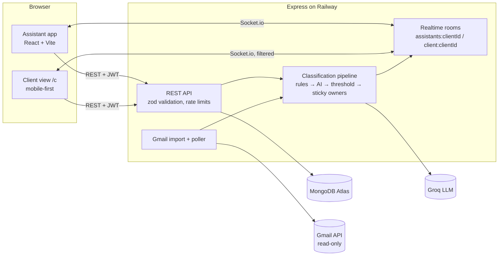

# Relay: AI inbox copilot for personal assistants

Relay helps a personal assistant (PA) manage their clients' inboxes. For every conversation, the AI decides **who needs to reply**: the assistant, the client, nobody, or "needs review" when it isn't sure. It also explains why, summarises the thread, pulls out dates and deadlines, and drafts replies. The client gets a small, mobile-first view showing only what needs them, kept in sync with the assistant in real time.

Built as a prototype for the *AI Full-Stack Engineer Intern* assignment (Humanity Founders).

**Live demo:** https://web-one-zeta-74.vercel.app  ·  **API health:** https://relayserver-production-ab0bdc31.up.railway.app/api/health

> The API runs on Railway (see [docs/DEPLOY.md](docs/DEPLOY.md)).

---

## Try it in one click
On the login page:

| Button | You are | What to look at |
|---|---|---|
| **Assistant (Alex)** | A PA managing two clients (Priya, a founder; Daniel, a VC) | Today, Inbox, the AI panel on a thread, ⌘K / Ask AI, **Simulate email** |
| **Client (Priya)** | The client | Only the threads that need Priya, each with a "Why you" line. Let Alex take over, or reply with a note that Alex turns into a draft |

Both demo accounts use the password `demo1234` (`alex@example.com`, `priya@example.com`, `daniel@example.com`).
New sign-ups go through onboarding with a demo inbox. Test users approved on the Google Cloud project can also **Continue with Google** and connect their real Gmail (read-only).

A good 2-minute tour:
1. Log in as **Alex**. **Today** shows the morning brief, counts per owner, items to review and upcoming dates.
2. Open **Inbox** and use the segments (Assistant, Client, Needs review, No reply, Waiting…). Open a thread to see the owner, the confidence, the AI's reason, a summary and dates.
3. Change an owner (or press `o`) and tick **"Always do this for …"**. Relay creates a sender rule, and uses your correction as an example the next time it classifies.
4. Press **Simulate email**. A new email arrives and is classified live. One scenario adds a reply to an existing thread that changes who should answer, and the thread gets a "Reclassified" chip.
5. Open the client view as **Priya** in another window. Press **Assistant take over** and watch Alex's inbox update.

## How the AI works
- **Provider:** Groq (`openai/gpt-oss-120b`, plus `gpt-oss-20b` for bulk Gmail sync), behind a small provider interface. Gemini and Anthropic adapters exist, and a keyword-based **mock** takes over when no key is set or the AI fails, so the app never breaks.
- **Classification:** the prompt gets the **whole thread** (latest 12 messages, quoted replies trimmed), the client's delegation notes and VIP senders, today's date with weekday and timezone, and up to 5 **recent human corrections** as examples. The model returns strict JSON (`owner, confidence, reason, clientReason, category, summary, keyPoints, entities…`), validated with zod. Small formatting slips are tolerated, and bad dates are dropped.
- **Guardrails:**
  - Low confidence (< 0.7) goes to *Needs review*, with the AI's suggestion attached.
  - Sender/domain **rules** win over the AI.
  - Owners set by a person are **sticky**: the AI can only suggest a change.
  - A failed AI call keeps the previous owner.
- **Other AI features:** a morning brief (cached for 2 hours), "Ask your inbox" (answers cite only real thread ids), reply drafts in three tones, and turning a client's note into a draft.
- **Limits:** timeouts cancel the request, retries follow Groq's `retry-after`, and AI routes are rate-limited per user.

## What's real vs simulated
| Area | Status |
|---|---|
| Sign up / log in (bcrypt + JWT), Sign in with Google | **Real** |
| Storage of threads, owners, drafts, rules, activity (MongoDB) | **Real** |
| AI: who replies + confidence + reason, summaries, dates, drafts, Ask, morning brief | **Real** Groq calls (mock fallback without a key) |
| Owner overrides, sender/domain rules, learning from corrections, re-classification on new mail | **Real** |
| Live assistant ↔ client sync (Socket.io) | **Real** |
| Gmail | **Real, read-only** for approved test users (import + polling every ~60 s). Demo accounts use a **simulated** connection |
| Sample mailbox for Alex / Priya / Daniel | **Simulated** (48 seeded threads) |
| New mail in the demo | **Simulated** ("Simulate email") |
| Sending replies | **Simulated**: saved to the thread, nothing leaves (also for real Gmail) |
| Changes written back to Gmail, Outlook, add to calendar | **Not done / simulated** |

Why read-only Gmail? `gmail.readonly` is a Google *restricted* scope. Until the app passes Google's verification, only test users listed on the OAuth consent screen can connect, so reviewers always have the demo inbox. Setup: [docs/GOOGLE_SETUP.md](./docs/GOOGLE_SETUP.md).

## Architecture

- **Web** (`/web`): React 18, TypeScript, Vite, Tailwind + shadcn/ui, TanStack Query, Zustand, Socket.io client. Deployed on Vercel.
- **Server** (`/server`): Node + Express (ESM), Mongoose, zod, Socket.io, `groq-sdk`, `googleapis`. Deployed on Railway.
- **Database:** MongoDB Atlas.
- The client's socket room only receives cleaned-up thread data: no AI reasoning, history or other owners' threads.

## Run locally
Requirements: Node 20+, a MongoDB (local or a free Atlas cluster). A Groq key is optional; without one the mock AI is used.
```bash
npm install
cp server/.env.example server/.env   # set MONGODB_URI; optionally AI_PROVIDER=groq + GROQ_API_KEY
cp web/.env.example web/.env         # defaults to http://localhost:4000
npm run seed                         # demo users + 48 sample threads
npm run dev                          # server :4000 + web :5173
```
Open http://localhost:5173 and use the demo buttons. Checks: `npm run lint`, `npm run typecheck`, `npm test`.

### Key environment variables (server)
| Variable | Purpose |
|---|---|
| `MONGODB_URI` | Database connection |
| `JWT_SECRET` | Token signing. **Must be your own random value in production** (with `NODE_ENV=production` the server refuses the default) |
| `CORS_ORIGIN` / `WEB_URL` | The web app's exact origin (no trailing slash) |
| `AI_PROVIDER`, `GROQ_API_KEY`, `GROQ_MODEL`, `GROQ_FAST_MODEL`, `AI_TIMEOUT_MS` | AI provider and limits |
| `DEMO_MODE` | Enables Simulate email / Reset demo for the demo account |
| `REAL_GMAIL`, `GOOGLE_CLIENT_ID`, `GOOGLE_CLIENT_SECRET`, `GOOGLE_REDIRECT_URI`, `TOKEN_ENC_KEY`, `GMAIL_IMPORT_LIMIT`, `GMAIL_POLL_SECONDS` | Optional real Gmail + Google sign-in |

## Security notes
- Every thread and client route checks ownership on the server. Clients can only reach their own queue.
- Gmail refresh tokens are AES-256-GCM encrypted at rest and never sent to the browser. Connecting Gmail needs a one-time confirmation from the logged-in user.
- Email bodies are rendered as plain text. Rate limits cover login/sign-up and every AI-triggering route.

## Project docs
| File | What |
|---|---|
| [docs/PRD.md](./docs/PRD.md) | Product requirements, flows, acceptance criteria |
| [docs/DESIGN_SYSTEM.md](./docs/DESIGN_SYSTEM.md) | Tokens, components, states, responsive rules |
| [docs/FRONTEND.md](./docs/FRONTEND.md) · [docs/BACKEND.md](./docs/BACKEND.md) | Web structure · API contract, data model, AI pipeline |
| [docs/ROADMAP.md](./docs/ROADMAP.md) · [docs/PROGRESS.md](./docs/PROGRESS.md) · [docs/DECISIONS.md](./docs/DECISIONS.md) | Task board · work log · decisions |
| [docs/GOOGLE_SETUP.md](./docs/GOOGLE_SETUP.md) | Google Cloud setup for real Gmail |
| [AGENTS.md](./AGENTS.md) | How the two AI coding agents (Gemini, Claude) shared the work |

## Known limitations
- Replies are never actually sent, and nothing is written back to Gmail (read-only scope).
- The first Gmail sync of 20 threads takes about a minute, because of Groq's free-tier rate limits.
- One server process: the Gmail poller and the AI caches are in memory, which is fine for a prototype.
